# Yomu

> **2.0.4 — частичная доработка.** Локальные книги и мангу можно привязать к существующим трекерам с ручным указанием глав. Другие сервисы и улучшения форматов ещё не реализованы; версия не проверена на устройстве.

[](https://github.com/adxptived/yomu/actions/workflows/ci.yml)
[](https://github.com/adxptived/yomu/releases/latest)
[](https://github.com/adxptived/yomu/releases/tag/nightly)
[](https://github.com/adxptived/yomu/releases)
[](LICENSE)

**Yomu** (読む — «читать») — Android-читалка книг, PDF, комиксов и манги для тех, кто читает на иностранных языках: словарь по тапу, перевод, сохранение слов с контекстом и интервальное повторение. Плюс встроенный редактор книг и манги и каталог онлайн-источников в духе Mihon.

Автор — **Shinoame** ([github.com/adxptived](https://github.com/adxptived)). **[Скачать APK](https://github.com/adxptived/yomu/releases/latest)** · [ночная сборка](https://github.com/adxptived/yomu/releases/tag/nightly) · [сообщить о проблеме](https://github.com/adxptived/yomu/issues/new/choose)

> Версия **2.0.4** — что нового, в [CHANGELOG.md](CHANGELOG.md). 1.0.0, 1.1.0 и 1.3.1 запускали на телефоне; **1.4.0–2.0.4 на реальном устройстве ещё не проверялись** — см. [docs/KNOWN_LIMITATIONS.md](docs/KNOWN_LIMITATIONS.md).

| Библиотека | История | Статистика | Каталог | Словарь | Настройки |
|---|---|---|---|---|---|
| 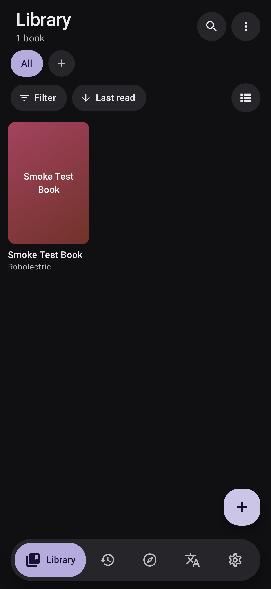 | 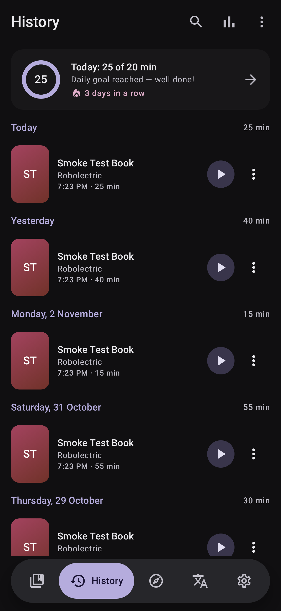 | 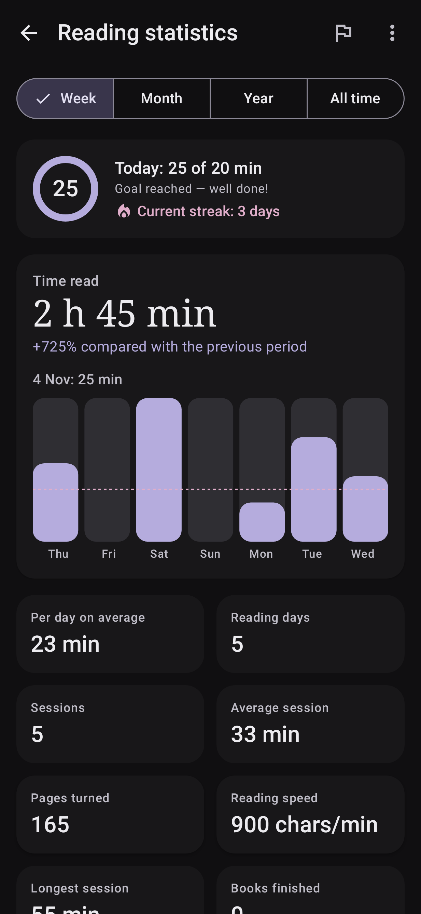 | 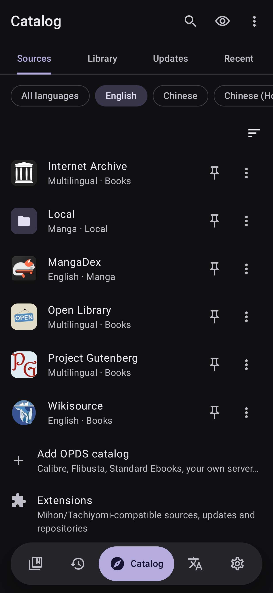 | 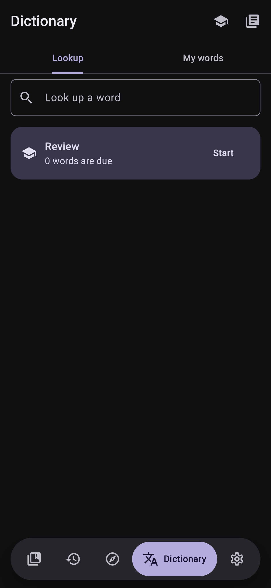 | 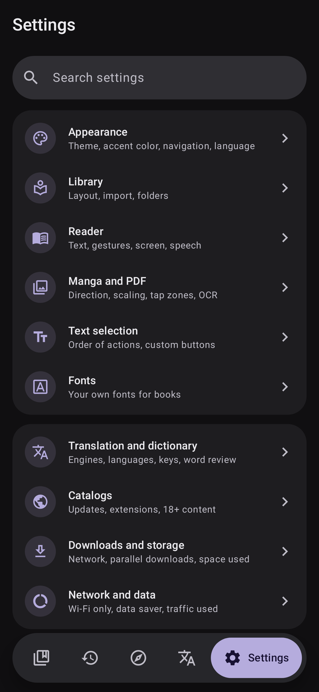 |

Новое в 2.0.4 — в карточке локальной книги или манги кнопка **Tracking** позволяет привязать файл к AniList, MyAnimeList или Shikimori. Главы, статус и оценку задавайте вручную: страницы файла не превращаются автоматически в номера глав. Привязки входят в резервную копию и отображаются в профиле, но не переносятся синхронизацией данных. Для входа в сервисы может потребоваться собственный ключ приложения — [TRACKING.md](docs/TRACKING.md). Резервные копии с файлами также включают книги, полученные по WebDAV. База обновляется со схемы 5 до 6.

Новое в 2.0.3 — необязательное копирование файлов книг через WebDAV с проверкой целостности. В Settings → Backup and sync выберите WebDAV и включите **Sync book files (WebDAV)** на каждом устройстве, затем запустите **Sync now**. Нужен сервер с сильными ETag и корректной поддержкой условной записи; используйте HTTPS. Файлы доступны серверу, не шифруются приложением и требуют места и трафика. Папки изображений и общая папка не поддерживаются; файлы автоматически не удаляются с сервера, а удалённая локально книга может вернуться. Изменённые после импорта файлы могут вызвать конфликт и потребовать ручного разбора.

Новое в 2.0.1 — вкладки «Трекинг» и «Загрузки» в профиле (все привязанные тайтлы с прогрессом и оценкой, отправка изменений и обновление с сервисов; очередь загрузок), исправленный трекинг Shikimori (сервис переехал на `shikimori.io`, вход и списки в 2.0.0 не работали), надёжное обновление токенов трекеров без выхода из аккаунта при сбое сервера, синхронизация WebDAV с серверами, которые сжимают ответы, и другие исправления по аудиту.

Новое в 2.0.0 — импорт библиотеки из Mihon/Tachiyomi (`.tachibk`), трекинг в Shikimori, AniList и MyAnimeList, ранобэ онлайн (RanobeLib, NovelBin), виджет «Продолжить чтение», перевод страницы манги через OCR прямо в редакторе, визуальная правка глав EPUB, правка метаданных сразу нескольких книг, перевод только выбранных глав, выделения PDF в самом файле, синхронизация через папку или WebDAV с удалениями и онлайн-библиотекой, настраиваемые меню долгого нажатия (круговое или список). База данных — схема 5; синхронизируемые устройства нужно обновить все.

Новое в 1.9.0 — плавное переключение вкладок (открытые вкладки остаются готовыми в фоне, новая начинает загружаться от касания панели, смена — с короткой анимацией), исправлен вылет при ошибке загрузки страницы тайтла, после сбоя приложение предлагает отправить отчёт (ошибка, экран и шаги перед сбоем), переключатель языка в верхней панели источников с отдельным источником на каждый язык (MangaDex, Wikisource, NHentai и другие).

Новое в 1.8.0 — вкладка «Профиль» вместо «Истории» (время чтения, серии, достижения, статистика и история, карточка профиля для отправки), парящая нижняя панель без подложки, сохраняемые фильтры списка источников в «Каталоге» (языки, содержимое, тип, 18+), каталог без подвисания, исправленные фильтры источников (теги, которые расширение подгружает в фоне, появляются сами, «Сбросить» работает всегда), зоны нажатий в манге не показываются при каждом открытии.

Новое в 1.7.0 — семь значков приложения (с тематическими для Android 13+), обновления прямо из приложения и «Что нового» после обновления:

| Значки: круг, квадрат, тематические | Выбор значка | Обновление | Скачивание | Карточка и точка на вкладке | Что нового |
|---|---|---|---|---|---|
| 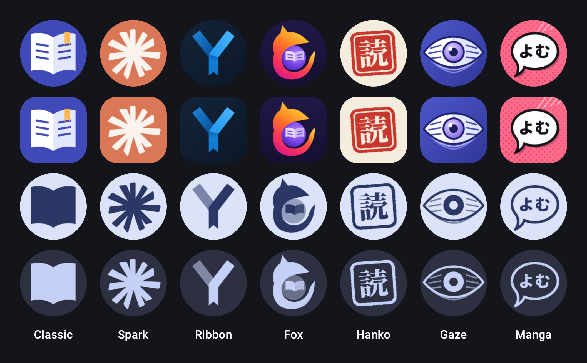 | 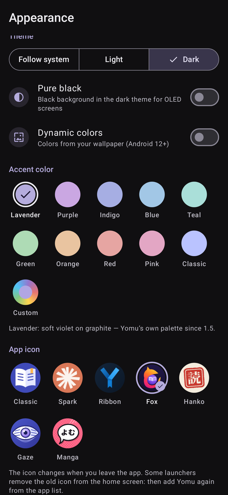 | 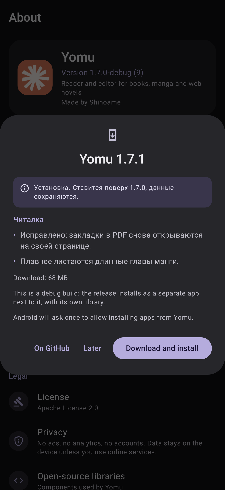 | 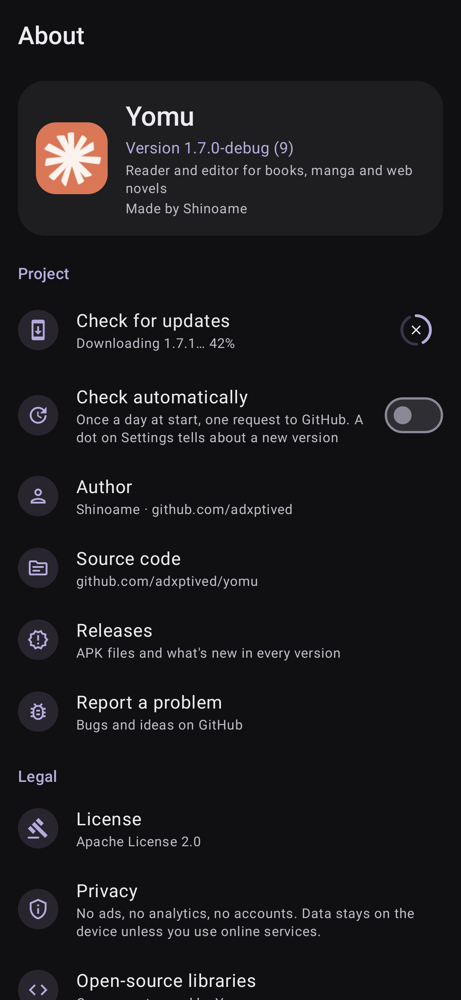 | 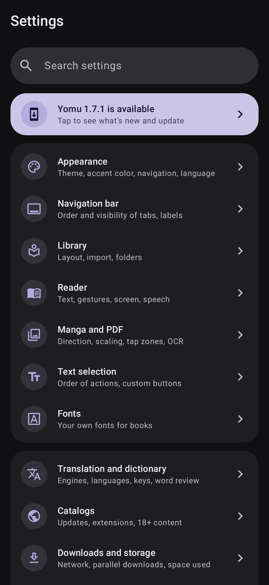 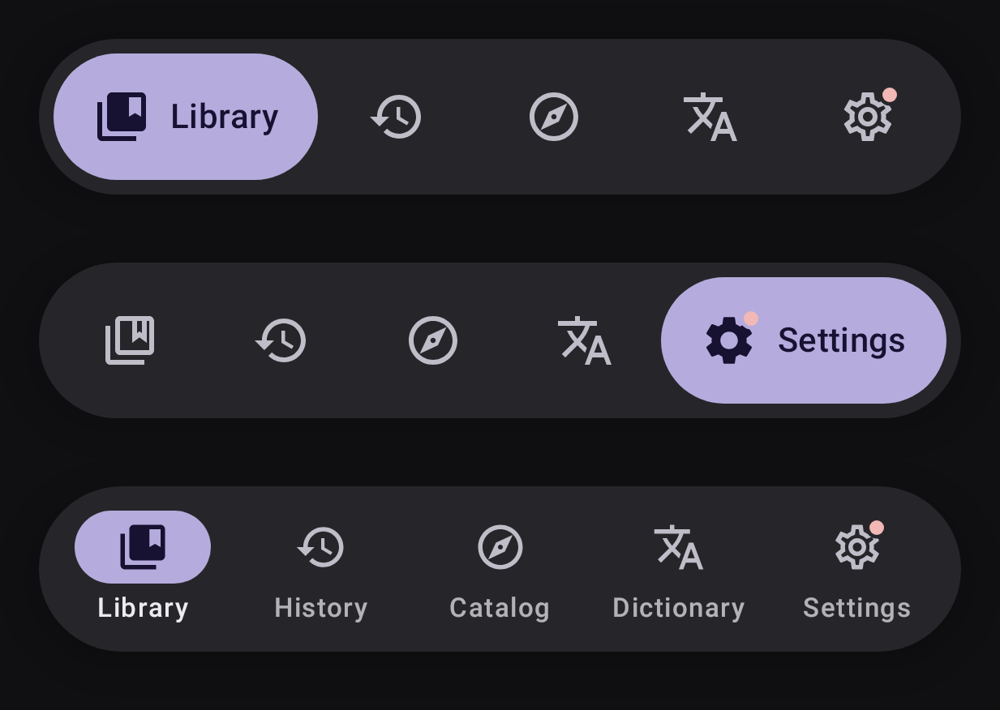 |  |

Новое в 1.6.0 — плавная панель навигации с настройкой вкладок, вкладки «Популярное / Новое / Поиск» у источников, «О приложении» с проверкой обновлений:

| Панель навигации | Настройка вкладок | Поиск и фильтры | «Новое» | О приложении |
|---|---|---|---|---|
| 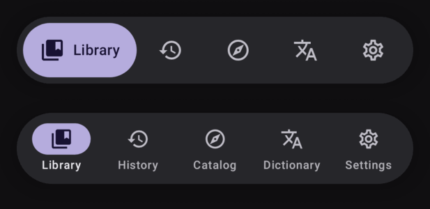 | 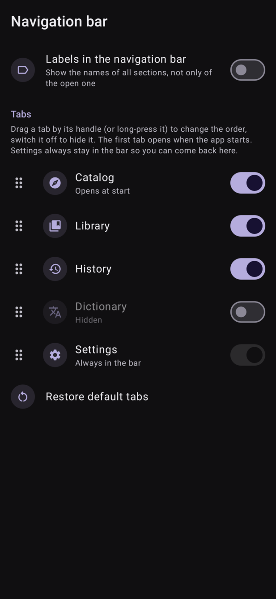 | 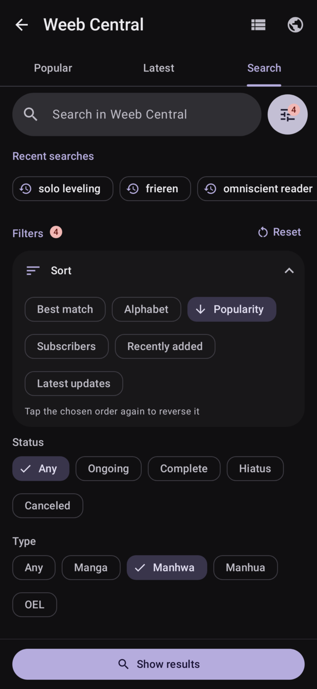 | 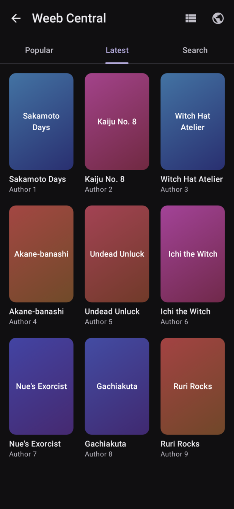 | 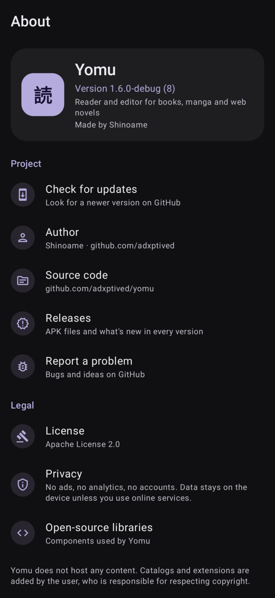 |

Новое в 1.5.0 — тёмный дизайн с лавандовым акцентом, свои вкладки, фильтр и выбор акцентного цвета:

| Только онлайн-тайтлы | Своя вкладка | Фильтр | Оформление | Другой акцент |
|---|---|---|---|---|
| 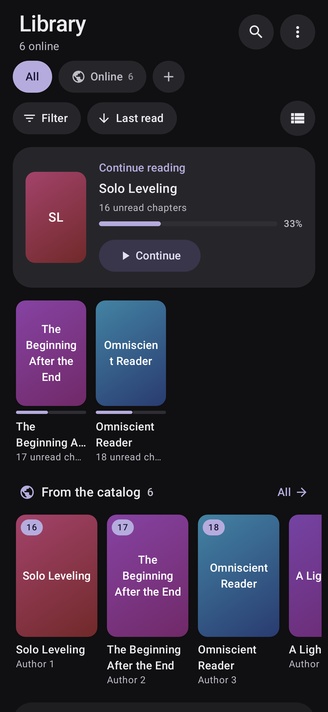 | 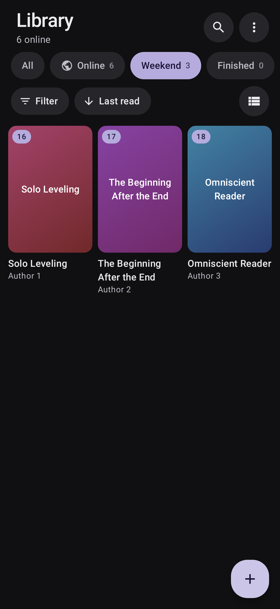 | 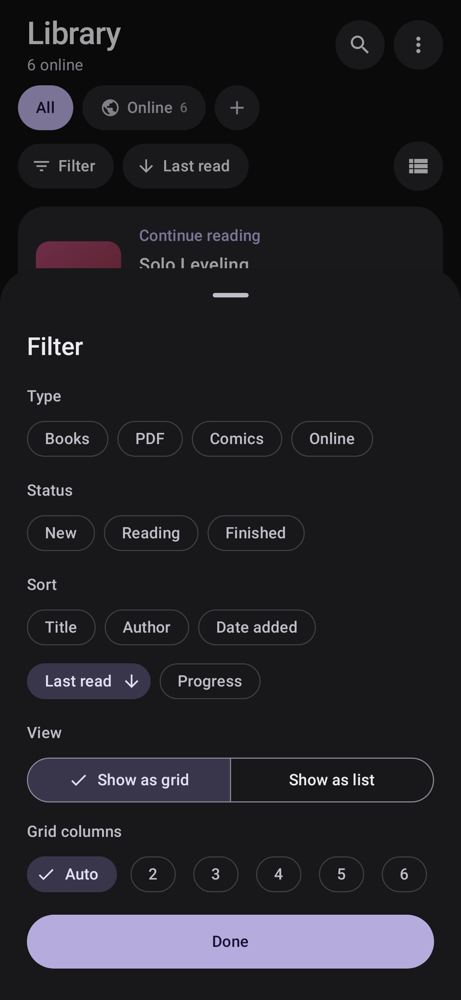 | 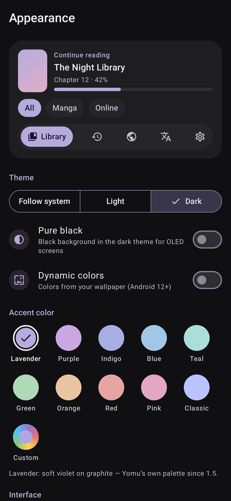 | 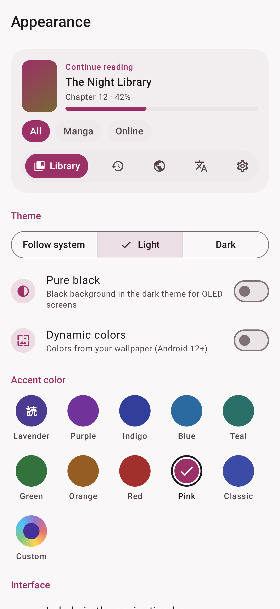 |

Новое в 1.4.0:

| Номера глав | Онлайн в библиотеке | Фильтры источника | Сеть и трафик |
|---|---|---|---|
| 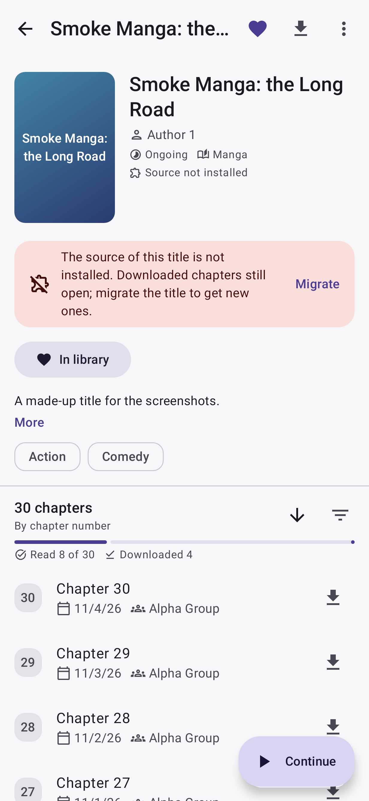 | 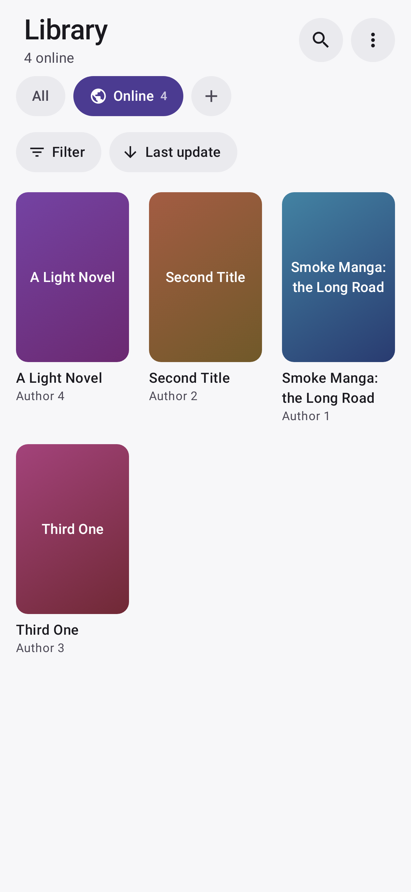 | 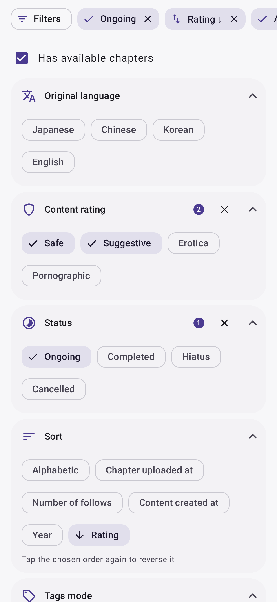 | 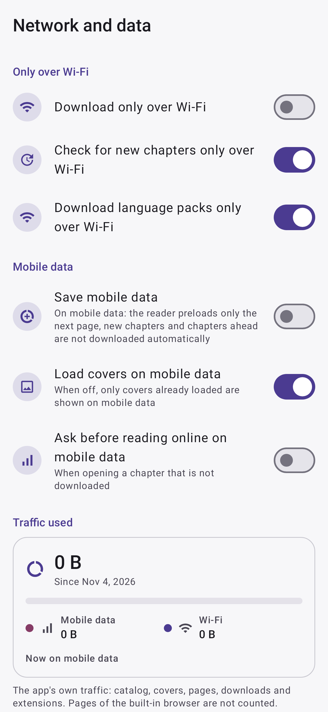 |

<sub>Скриншоты сняты Robolectric + Roborazzi из `AppSmokeTest` (без реального устройства).</sub>

## Возможности

**Чтение**
- EPUB, PDF, FB2/FB2.ZIP, MOBI/AZW3, DOCX, TXT, HTML, CBZ/ZIP, CBR/RAR, CB7/7Z и папки с картинками.
- Библиотека с обложками и метаданными, своими вкладками (книги и онлайн-тайтлы вместе), тегами, панелью фильтров, сортировками, «Продолжить чтение», поиском и массовыми действиями; автосканирование папок; режимы «копировать»/«ссылаться».
- Текст: шрифты (в том числе свои), размеры, интервалы, поля, темы и пресеты оформления, пагинация или прокрутка, тап-зоны, кнопки громкости, озвучивание с подсветкой и таймером сна, поиск, оглавление.
- Позиция: «страница N из ≈M», переход к странице или проценту, предпросмотр при перетаскивании ползунка, «вернуться на стр. N», время до конца главы и книги, строка состояния с часами и зарядом.
- DOCX — дополнительно режим **«Разметка страницы»**: страницы A4 как при печати (поля, колонтитулы, сноски, таблицы, картинки, нумерация).
- **Профиль** (с 1.8.0): время чтения, серии, достижения, карточка для отправки, CSV истории, вкладки «Трекинг» и «Загрузки» (с 2.0.1); **история** чтения по дням и **статистика**: время, сеансы, скорость, серии, дневная цель, графики по дням, часам и дням недели.
- Манга: слева направо (по умолчанию), справа налево, вертикально, вебтун; зум, развороты, предзагрузка, фон страниц, фильтры изображения, раскладки тап-зон с подсказкой. PDF: зум, поиск, выделение, пароли, ночной режим, обрезка полей, OCR сканов для перевода.

**Язык**
- Плавающая панель выделения с настраиваемыми кнопками (копировать, выделить, заметка, словарь, перевод, озвучить, поиск, поделиться, свои URL и приложения); «Найти в Yomu» из других приложений.
- Офлайн-словари StarDict, DSL, JMdict, Wiktionary; онлайн-словарь; лемматизация (en/ru) и деинфлексия японского.
- Перевод офлайн (ML Kit) и онлайн (Google, DeepL, LibreTranslate, любой OpenAI-совместимый LLM); перевод книги целиком или двуязычная версия.
- Слова с контекстом, карточки повторения (SM-2), дневная цель и напоминания, экспорт CSV/Anki.

**Заметки** — выделения цветами, заметки в Markdown с #тегами (к выделению или к странице), закладки с отметками на полосе прогресса, цитаты-картинки; поиск и экспорт в Markdown (Obsidian), JSON, HTML, TXT, Readwise CSV.

**Редактор** — EPUB: метаданные, обложка, главы (порядок, разделение, объединение), оглавление, визуальная правка главы, перевод выбранных глав, XHTML/CSS с подсветкой, поиск/замена с regex, чистка текста и стилей, изображения, проверка с автоисправлением. Манга: порядок страниц, поворот, обрезка полей, цветокоррекция, развороты, пережатие, ComicInfo, перевод страницы через OCR с вписыванием текста в облачка. Правка метаданных нескольких книг сразу. Undo/redo переживает перезапуск.

**Каталог** — OPDS (Project Gutenberg, Standard Ebooks, Feedbooks, ManyBooks, свои серверы Calibre/Kavita/Komga), Gutendex, Open Library/Internet Archive, локальная папка; **расширения Mihon/Tachiyomi** из репозиториев (в том числе по ссылке «Add to Mihon/Tachiyomi») и пять встроенных, проверенных вживую: MangaDex, MANGA Plus, Webtoons, GlobalComix, AComics; ранобэ — RanobeLib и NovelBin; импорт библиотеки из резервной копии Mihon/Tachiyomi; трекинг в Shikimori, AniList и MyAnimeList; фильтры, избранное по вкладкам, сортировка и фильтры глав и библиотеки, обновления глав, история, глобальный поиск, миграция, WebView для Cloudflare; тайм-ауты и автоповторы запросов к источникам; очередь загрузок с паузой, приоритетом и автоповторами, параллельной загрузкой страниц, автозагрузка новых глав и «Докачивать при чтении», офлайн-чтение. Номера глав по порядку чтения, тайтлы с сердечком прямо в «Библиотеке» (вкладка «Онлайн» и свои вкладки), фильтры источников чипами с поиском и активными фильтрами над результатами, история поиска.

**Сеть и трафик** — «только по Wi-Fi» для загрузок, обновлений и языковых пакетов, экономия мобильного трафика (меньше предзагрузки, без автозагрузок), обложки и предупреждение перед чтением в мобильной сети, счётчик трафика приложения (мобильная сеть / Wi-Fi).

**Прочее** — резервные копии (вручную и по расписанию), синхронизация через общую папку или WebDAV (с удалениями и онлайн-библиотекой), виджет «Продолжить чтение», выделения PDF в самом файле, настраиваемые меню долгого нажатия, блокировка PIN/биометрией, скрытие из недавних, инкогнито, журнал ошибок, тёмная (по умолчанию), светлая и AMOLED-тема, 11 акцентных цветов и свой цвет или Material You, семь значков приложения (с тематическими для Android 13+), обновления из GitHub Releases прямо в приложении (с проверкой SHA-256), английский и русский интерфейс, телефоны и планшеты (адаптивная навигация).

## Установка

Android 8.0+ (API 26). Скачайте APK из [последнего релиза](https://github.com/adxptived/yomu/releases/latest): `yomu-vX.Y.Z-arm64-v8a.apk` — для телефонов и планшетов, `yomu-vX.Y.Z-x86_64.apk` — для эмуляторов и x86-устройств (до 1.5.0 файлы назывались `app-arm64-v8a-release.apk` и `app-x86_64-release.apk`). Контрольные суммы — в `SHA256SUMS.txt`. Обновляться можно прямо из приложения: «Настройки → О приложении → Проверить обновления» покажет, что нового, скачает APK для вашего устройства, сверит его SHA-256 с `SHA256SUMS.txt` и откроет системный установщик (Android один раз спросит разрешение на установку из Yomu). Там же можно включить проверку раз в день — тогда о новой версии подскажут точка на вкладке «Настройки» и карточка вверху настроек; по умолчанию приложение само в сеть не ходит. Debug-сборка (`*.debug`) ставится рядом с release, поэтому релиз из неё установится отдельным приложением.

**Обновление с 1.2.0 и более ранних версий.** Android ставит новую версию поверх старой, только если подпись совпадает. APK 1.3.1 из этого релиза подписан новым постоянным ключом (ключ, которым подписана 1.2.0, не сохранился), поэтому сначала сделайте резервную копию («Настройки → Резервные копии и синхронизация → Создать резервную копию»), удалите старую версию, установите 1.3.1 и восстановите копию. База данных 1.2.0 обновится сама (схема 3). Следующие версии подписывайте тем же ключом, что и 1.3.1, — тогда они ставятся поверх без удаления.

**Обновление с 1.3.1 и 1.4.0** — 1.5.0 подписана тем же ключом и ставится поверх, данные сохраняются. База обновится сама до схемы 4: категории онлайн-библиотеки станут вкладками.

**Обновление с 1.5.0** — 1.6.0 ставится поверх, если подписана тем же ключом; база данных не меняется.

**Обновление с 1.6.0** — 1.7.0 ставится поверх (тот же ключ), база данных не меняется. Значок на рабочем столе остаётся: прежний вход `.MainActivity` теперь значок «Классика».

**Обновление с 1.7.0** — 1.8.0 ставится поверх (тот же ключ), база данных не меняется; сохранённые фильтры источников 1.7 читаются.

**Обновление с 1.8.0** — 1.9.0 ставится поверх (тот же ключ), база данных не меняется.

**Обновление с 1.9.0** — 2.0.0 ставится поверх (тот же ключ); база данных обновится сама до схемы 5 (трекинг). Если пользуетесь синхронизацией, обновите все устройства: 1.9.0 не знает об удалениях и онлайн-библиотеке в файле синхронизации. Выделения PDF с 2.0.0 записываются и в сами PDF-файлы (выключается в «Настройки → Манга и PDF»).

**Обновление с 2.0.0** — 2.0.1 ставится поверх (тот же ключ), база данных не меняется. Если вход в Shikimori в 2.0.0 не получался, войдите заново в «Настройки → Трекинг».

## Сборка

Требуется JDK 17 или 21 и Android SDK (platform 36, build-tools 36). Укажите SDK в `local.properties` (`sdk.dir=/path/to/Android/sdk`) или переменной `ANDROID_HOME`.

```bash
./gradlew assembleDebug          # app/build/outputs/apk/debug/
./gradlew assembleRelease        # app/build/outputs/apk/release/ (R8 + shrinkResources)
./gradlew assembleFast           # app/build/outputs/apk/fast/ — debug-приложение, собранное как release
./gradlew test                   # все unit-тесты (JUnit 5) + Robolectric smoke-тест приложения
./gradlew assembleRelease -PYOMU_ANILIST_CLIENT_ID=… -PYOMU_MAL_CLIENT_ID=… -PYOMU_SHIKIMORI_CLIENT_ID=… -PYOMU_SHIKIMORI_CLIENT_SECRET=…   # ключи трекеров, см. docs/TRACKING.md
./gradlew :app:testDebugUnitTest -Proborazzi.test.record=true   # + скриншоты в app/build/outputs/roborazzi
./gradlew detekt lint            # статический анализ
```

**Подпись debug.** С 1.9.0 debug-сборки подписываются общим ключом из репозитория — `gradle/debug.keystore` (пароль `android`): debug-APK с любого компьютера и из CI ставятся поверх друг друга (с ключом прежних сборок — один раз переустановить). Ключ открытый намеренно и подписывает только `app.yomu.reader.debug`, не release. Плавность анимаций оценивайте на release- или fast-сборке: debug заметно медленнее (код не оптимизирован R8, Android выполняет отлаживаемое приложение без предкомпиляции). Сборка `fast` (`./gradlew assembleFast`) — то же debug-приложение (`app.yomu.reader.debug`, тот же ключ), но собранное как release (R8, без отладки): ставится поверх debug-сборки и обратно, данные сохраняются. Имена в её журналах сбоев сокращены R8 (номера строк остаются), расшифровка — по `app/build/outputs/mapping/fast/mapping.txt` той же сборки.

**Подпись release.** Без переменных окружения release подписывается локальным debug-ключом (удобно для проверки). Опубликованные APK подписаны постоянным ключом — обновления ставятся поверх, только если подпись совпадает. Для публикации:

```bash
export YOMU_KEYSTORE_PATH=/path/release.jks YOMU_KEYSTORE_PASSWORD=… YOMU_KEY_ALIAS=yomu YOMU_KEY_PASSWORD=…
./gradlew assembleRelease
```

**Автосборка на GitHub.** Тег `vX.Y.Z` собирает подписанные APK и публикует релиз, каждый зелёный коммит в `main` — пре-релиз `nightly`. Ключ подписи хранится в секретах репозитория (`YOMU_KEYSTORE_BASE64`, `YOMU_KEYSTORE_PASSWORD`, `YOMU_KEY_ALIAS`, `YOMU_KEY_PASSWORD`). Как настроить и выпустить версию — [docs/RELEASING.md](docs/RELEASING.md).

Сборка рассчитана на 4 ГБ памяти (`org.gradle.jvmargs=-Xmx2400m`, 2 воркера); на машине с 8+ ГБ можно увеличить.

## Словари

«Словарь → значок книг → Импорт» и выберите файл или ZIP-архив:
- **StarDict** — `.ifo` + `.idx` + `.dict`/`.dict.dz` (можно одним ZIP);
- **DSL** (ABBYY Lingvo) — `.dsl` или `.dsl.dz`;
- **Wiktionary** — JSON/JSONL-выгрузки [kaikki.org](https://kaikki.org) (`.jsonl`, `.jsonl.gz`);
- **JMdict** — `JMdict_e.xml`/`.gz`.

Импорт идёт в фоне, словари можно включать/выключать и сортировать. Подробнее — [docs/USER_GUIDE.md](docs/USER_GUIDE.md#словарь-перевод-и-слова).

## Расширения-источники

- **Mihon/Tachiyomi** (lib 1.4 и 1.6): «Каталог → ⋮ → Расширения → Репозитории» — адрес `index.min.json`/`repo.json`, страница GitHub или ссылка «Add to Mihon/Tachiyomi» на сайте репозитория. Пять расширений Keiyoushi встроены.
- **API Yomu**: класс `CatalogSource` из модуля `source-api`, упакованный в APK с meta-data `yomu.extension.class` — для книг и ранобэ.

Подробности, проверка подписи и пошаговый гайд — [docs/EXTENSIONS.md](docs/EXTENSIONS.md).

## Документация

- [Руководство пользователя](docs/USER_GUIDE.md) · [Изменения](CHANGELOG.md) · [Релизы и автосборка](docs/RELEASING.md)
- [Архитектура](docs/ARCHITECTURE.md) · [Решения](docs/DECISIONS.md) · [Прогресс по плану](docs/PROGRESS.md) · [Известные ограничения](docs/KNOWN_LIMITATIONS.md)
- [Расширения](docs/EXTENSIONS.md) · [Трекинг](docs/TRACKING.md) · [Приватность](docs/PRIVACY.md) · [Как помочь проекту](CONTRIBUTING.md)
- Исходное ТЗ — [plan.md](plan.md); что ещё не сделано — [docs/НЕ_СДЕЛАНО.md](docs/НЕ_СДЕЛАНО.md); состояние до доработки — [docs/history/](docs/history/)

## Лицензия

[Apache License 2.0](LICENSE).

Основные зависимости: AndroidX/Jetpack Compose, Kotlin, kotlinx.coroutines/serialization, Koin, OkHttp/Okio, Coil, telephoto, Timber, Apache Commons Compress, RxJava, quickjs-java — Apache-2.0; Injekt — MIT; QuickJS — MIT; слой совместимости `compat/tachiyomi` и встроенные расширения — код Mihon/Keiyoushi, Apache-2.0 (см. NOTICE в модуле и в `app/src/main/assets/extensions`); шрифты для разметки DOCX — Liberation и Carlito, SIL OFL 1.1; Jsoup — MIT; XZ for Java — 0BSD; PDFium (через `io.legere:pdfiumandroid`, Apache-2.0) — BSD-3-Clause; **junrar — лицензия UnRAR** (распаковка разрешена, создание RAR-архивов — нет); **Google ML Kit — проприетарные условия Google** (офлайн-перевод, определение языка, OCR). Для сборки без проприетарных компонентов (F-Droid) ML Kit нужно вынести в отдельный flavor — см. KNOWN_LIMITATIONS.
