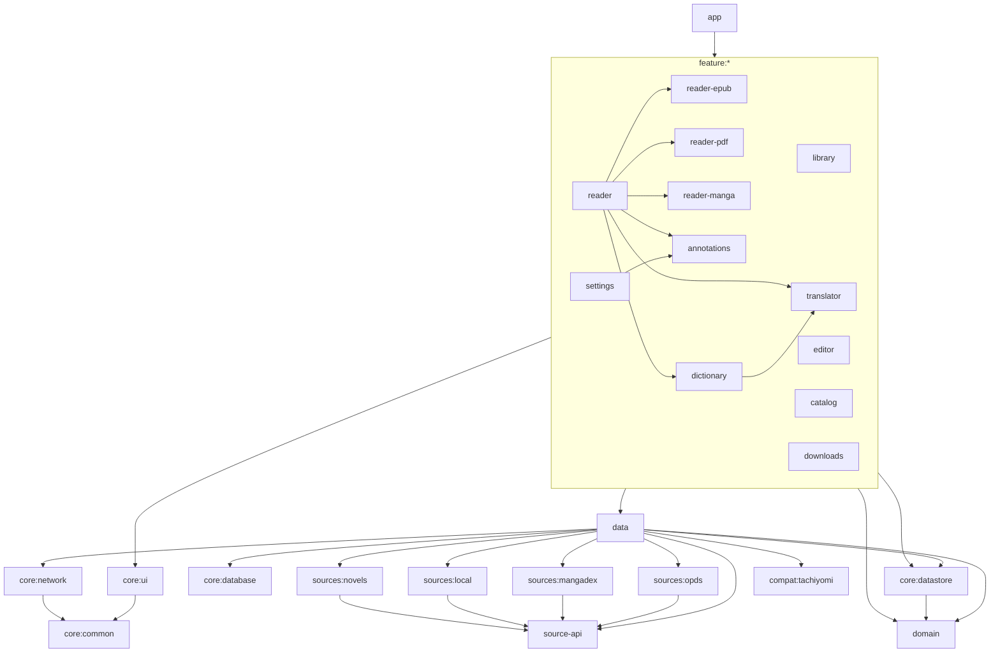

# Архитектура Yomu

Одно Android-приложение (Kotlin, Jetpack Compose, Material 3) с тремя режимами: **читалка**, **редактор** и **каталог источников**. Многомодульный Gradle-проект; общие настройки модулей — convention plugins в `build-logic/`, версии — `gradle/libs.versions.toml`.

## Модули



| Модуль | Тип | Содержимое |
|---|---|---|
| `app` | Android app | `YomuApp` (Koin, Coil, каналы уведомлений, планировщик задач), `MainActivity`, навигация (`navigation/`), onboarding, блокировка приложения, обработка интентов VIEW/SEND/PROCESS_TEXT, виджет «Продолжить чтение» (`widget/`), вход в трекеры (`TrackLoginActivity`, адреса `yomu://…-auth`), автосинхронизация (`AutoSync`) |
| `core:common` | Android lib | `UiState`, `AppError`, файлы/SAF, `Share`, журнал ошибок `ErrorLog` |
| `core:ui` | Android lib | тема (`YomuTheme`, акценты, AMOLED), общие компоненты (сетки, листы, диалоги, настройки, пустые/ошибочные состояния, подсказки), `KeyBus` для аппаратных кнопок |
| `core:database` | Android lib | Room: сущности, DAO, FTS4 для библиотеки, миграции |
| `core:datastore` | Android lib | `AppSettings` — все настройки на DataStore Preferences, экспорт/импорт JSON |
| `core:network` | Android lib | общие клиенты OkHttp (кеш, таймауты, cookie из WebView) |
| `domain` | Kotlin/JVM | модели (книги, локаторы, аннотации, слова, каталог), интерфейсы репозиториев, SM-2, лемматизация, деинфлексия японского, поиск/замена, типографика, экспорт аннотаций и слов |
| `data` | Android lib | импорт и метаданные, контейнеры (ZIP/RAR/7z/папка), парсер и writer EPUB, конвертеры FB2/TXT/HTML/DOCX/MOBI → EPUB, PDF (PDFium), репозитории, словари (StarDict/DSL/JMdict/Wiktionary), перевод (ML Kit + онлайн-движки), OCR, каталог, расширения, загрузки, WorkManager-задачи, бэкап, импорт Mihon (`backup/MihonImporter`), синхронизация 2.0 (`SyncManager`, `SyncMerger`, `SyncBackends`: папка SAF / WebDAV), трекеры (`tracking/`: Shikimori, AniList, MyAnimeList), запись аннотаций в PDF (`book/pdf/`: свой разбор и инкрементальная запись PDF на JVM) |
| `source-api` | Kotlin/JVM | публичный API источников для расширений (`Source`, `CatalogSource`, `HttpSource`, модели, фильтры) |
| `sources:*` | Kotlin/Android | OPDS (+ Gutendex, Open Library/Internet Archive), MangaDex, локальная папка, новеллы (`sources:novels`: RanobeLib, NovelBin) |
| `compat:tachiyomi` | Android lib | публичный API расширений Mihon/Tachiyomi (`eu.kanade.tachiyomi.*`, lib 1.4/1.6: источники, модели, фильтры, `NetworkHelper`, интерсепторы, `JavaScriptEngine`), Injekt-граф для расширений, мост Rx ↔ coroutines |
| `feature:library` | Android lib | библиотека (Paging, сетка/список, фильтры, коллекции, массовые действия), карточка книги |
| `feature:reader*` | Android lib | общий экран чтения (оверлей, настройки, TTS, поиск, оглавление, статистика) и движки: EPUB (WebView + JS), PDF (PDFium + зум), манга (страницы/лента/вебтун) |
| `feature:annotations` | Android lib | выделения, заметки, закладки, цитаты, экспорт/импорт |
| `feature:dictionary`, `feature:translator` | Android lib | поиск слов, мои слова, повторение, словари; перевод выделения, языковые пакеты, перевод книги |
| `feature:editor` | Android lib | редактор EPUB (метаданные, главы, оглавление, визуальная правка `VisualEditor`, XHTML/CSS, поиск/замена, чистка, изображения, проверка, перевод выбранных глав) и манги (страницы, обрезка, цвет, развороты, ComicInfo, перевод страницы: `Typeset`, `MangaTypesetUi`) с undo/redo |
| `feature:catalog` | Android lib | источники, просмотр/поиск с фильтрами, тайтл и главы, избранное и вкладки, обновления, история, глобальный поиск, миграция, расширения, WebView |
| `feature:downloads` | Android lib | очередь загрузок, пауза/повтор, хранилище |
| `feature:settings` | Android lib | все разделы настроек, шрифты, блокировка, бэкап/синхронизация, журнал ошибок, «О приложении» |

## Слои и потоки данных

```
Compose UI  ──события──▶  ViewModel (StateFlow<UiState>)  ──▶  Repository / Service (data)  ──▶  Room · DataStore · файлы · сеть
     ▲                              │
     └────────── состояние ─────────┘
```

- **UI** — только Compose; экраны получают ViewModel через `koinViewModel()` (параметры маршрута — `parametersOf`).
- **ViewModel** держит `StateFlow` состояния, одноразовые события — через `Channel`; длительные операции — `viewModelScope` + `Dispatchers.IO`.
- **Ошибки** приводятся к `AppError` (`AppError.from`, `runCatchingApp`) и показываются `ErrorState`/снекбаром; необработанные исключения пишет `ErrorLog` (экран «Журнал ошибок»).
- **DI** — Koin: модуль на каждый feature + `dataModule` + `appModule`; список — `yomuModules` в `YomuApp.kt`.

### Импорт книги
`SAF Uri / файл → FormatDetector (сигнатура + расширение) → MetadataExtractor (обложка, автор, серия, язык) → [конвертация в EPUB для FB2/TXT/HTML/DOCX/MOBI] → BookEntity (Room) → библиотека (Paging)`. Режимы «копировать» и «ссылаться»; дубликаты — по SHA-1 начала файла + размеру. Сканирование папок — `LibraryScanWorker`.

### Чтение
`ReaderRoute(bookId, locator) → ReaderViewModel → движок по формату (EPUB/PDF/манга)`. Позиция — `Locator` (глава, прогресс, смещение текста); сохраняется с debounce и при выходе; сеансы чтения (`reading_sessions`) пишутся для истории и статистики (`ReadingHistoryRepository`, `StatsCalculator`). DOCX дополнительно открывается в «Разметке страницы»: `DocxLayout` (DOCX → HTML с геометрией страниц) + `paginate.js` в WebView (`DocxLayoutScreen`). Выделение текста → плавающая панель (настраиваемые действия: копировать, выделить, заметка, словарь, перевод, озвучить, поиск, поделиться, свои URL/приложения).

### Словарь и перевод
Тап по слову → `Lemmatizer`/`JapaneseDeinflector` → офлайн-словари (Room) → онлайн-словарь (если разрешён) → перевод (ML Kit офлайн или выбранный онлайн-движок; кеш переводов) → «Сохранить слово» вместе с предложением-контекстом → повторение по SM-2.

### Каталог
`SourceManager` (встроенные + OPDS + локальная папка + расширения; фильтр языков) → `CatalogRepository.browse/search` (Paging) → тайтл и главы в Room → загрузка (`DownloadRepository` + `DownloadWorker`, foreground) → чтение офлайн. `UpdateWorker` проверяет новые главы избранного.

Расширения: `ExtensionStores` читает репозитории (legacy `index.min.json` + `repo.json`, index v2 protobuf/JSON), `ExtensionManager` ставит APK в приватную папку (только чтение) или находит установленные пакеты, проверяет подпись, грузит классы (`DelegateLastClassLoader` из Mihon) и оборачивает источники Mihon/Tachiyomi в `TachiyomiSource`; встроенные APK копируются из `assets/extensions` при запуске.

### Редактор
`EditorViewModel` распаковывает книгу в рабочую папку (`EpubWorkspace` / `MangaWorkspace`); каждое изменение — шаг `History` (снимки затронутых файлов до/после, переживает перезапуск). «Сохранить» упаковывает EPUB/CBZ (mimetype первым, без сжатия), проверяет его парсером и заменяет оригинал или сохраняет копию.

### Фоновые задачи (WorkManager)
`LibraryScanWorker`, `DownloadWorker`, `UpdateWorker`, `BackupWorker`, `SyncWorker`, `ReminderWorker`, `BookTranslationWorker`, `PdfAnnotationWorker` (выделения → PDF-файл, через 2 с после изменения) — расписание задаёт `WorkScheduler` по настройкам.

## Хранилище

- `files/books` — скопированные книги, `files/converted` — EPUB-копии сконвертированных форматов, `files/covers` — обложки, `files/downloads` — главы и книги из каталога, `files/editor` — черновики редактора и их история, `files/dict` — данные словарей.
- Room-база `yomu.db`; настройки — DataStore `settings.preferences_pb`.
- Резервная копия — ZIP: `backup.json` (таблицы + настройки) и опционально `files/`.
